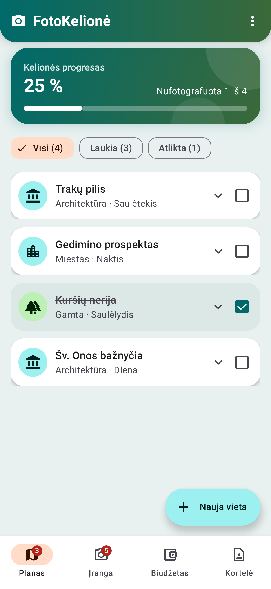

# FotoKelionė

Android programėlė, padedanti fotografams pasiruošti fotografavimo kelionei: vietų planavimas, įrangos pakavimas ir biudžeto skaičiavimas.

Autorius: Gabrielius Vaišvila, grupė MKDf-23/2, VILNIUS TECH.

## Ekranai

- **Planas** – fotografavimo vietos (kategorija, paros metas, prioritetas, lauke / patalpoje), filtrai *Visi / Laukia / Atlikta*, progreso juosta, pridėjimas per FAB su pavadinimo tikrinimu, šalinimas su „Atšaukti“ Snackbar'e.
- **Įranga** – daiktų žymėjimas supakuotais, supakuoto svorio skaičiavimas, bagažo limito slankiklis ir įspėjimas jį viršijus.
- **Biudžetas** – naktys, skrydis, viešbutis, dienos išlaidos ir transporto būdas → bendra suma ir vidurkis per dieną, pasirenkamas 10 % rezervas. Priimamas kablelis ir taškas.
- **Kortelė** (2 etapas) – vizitinė kortelė: nuotrauka (galima nufotografuoti save kamera), el. paštas, CV ir portfolio (nuotraukos kraunamos iš interneto per Coil). Pridėti įrašai išsaugomi telefone. Forma „Susisiekite su manimi“ siunčia laišką per el. pašto programėlę (Intent).

Programėlė yra lietuvių ir anglų kalbomis (meniu ⋮ → „Kalba“).

Telefone naviguojama apatine juosta, planšetėje – `NavigationRail`; tinkleliai patys pritaiko stulpelių skaičių.

## Gynimui

Publikavimas Google Play – **[docs/PUBLIKAVIMAS.md](docs/PUBLIKAVIMAS.md)**.

Išsamus gidas – **[docs/GYNIMAS.md](docs/GYNIMAS.md)**: kur kode rasti kiekvieną reikalavimą, kaip veikia duomenų srautas, unit testai ir tikėtini klausimai su atsakymais.



## Struktūra

| Failas | Paskirtis |
| --- | --- |
| `Logic.kt` | Grynoji logika: tikrinimas, skaičių apdorojimas, biudžeto formulė |
| `PlannerViewModel.kt` | Būsena ir veiksmai ekranams Planas, Įranga, Biudžetas |
| `CardViewModel.kt` | Vizitinės kortelės duomenys ir jų saugojimas (SharedPreferences) |
| `res/values/strings.xml`, `res/values-en/strings.xml` | Visi tekstai lietuviškai ir angliškai |
| `ui/FotoKelioneApp.kt` | Top App Bar, meniu „Autorius“, navigacija |
| `ui/components/Components.kt` | Bendri dizaino elementai (HeroCard, SectionCard, IconCircle) |
| `ui/theme/Theme.kt` | Spalvos, šriftai, kampų apvalumas |
| `ui/screens/` | `PlanScreen`, `GearScreen`, `BudgetScreen`, `CardScreen` |
| `app/src/test/.../LogicTest.kt` | Unit testai |

## Paleidimas

```bash
./gradlew assembleDebug        # APK: app/build/outputs/apk/debug/app-debug.apk
./gradlew testDebugUnitTest    # unit testai
```

Arba atidarykite projektą Android Studio ir paleiskite `app` konfigūraciją.
