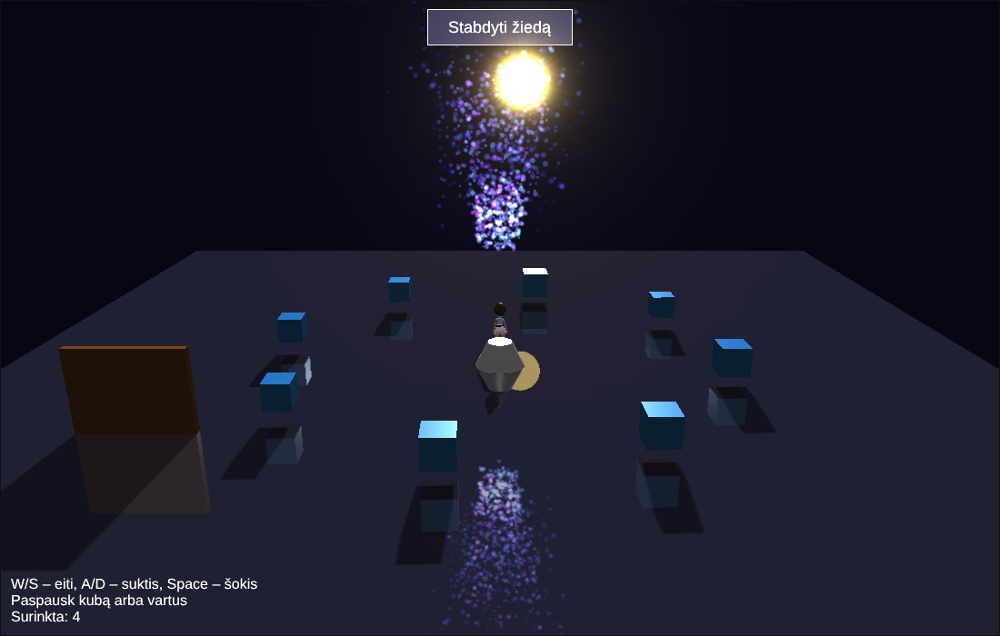

# 1 laboratorinis darbas – Babylon.js

Paleidimas: visą `lab1.js` turinį įklijuoti į https://playground.babylonjs.com ir spausti „Run“.

Valdymas: **W/S** – eiti pirmyn/atgal, **A/D** – suktis, **Space** – šokis + fejerverkas,
pelė – paspausti kubą (sprogimas) arba vartus (atsidaro/užsidaro), mygtukas viršuje – stabdyti/sukti žiedą.

| Kriterijus | Balai | Kas padaryta |
|---|---|---|
| Pivot ir/arba instance | 1 | `TransformNode` pivotas suka 8 kubų žiedą (1 kubas + 7 `createInstance`); vartai sukasi apie kraštą per `setPivotPoint` |
| Meshas iš bibliotekos | 1 | `HVGirl.glb` iš `assets.babylonjs.com/meshes/` su animacijomis Idle/Walking/WalkingBack/Samba |
| Šešėliai ir veidrodis | 1 | `ShadowGenerator` (blur ESM) + `MirrorTexture` ant žemės (atspindi ir daleles) |
| Mesh interactions | 1 | `intersectsMesh` – mergina paliečia kubą (išsipučia, sprogsta, skaitliukas); `intersectsPoint` – įlipus į fontaną jis trykšta stipriau |
| Dalelių sistema | 2 | Fontanas su gravitacija ir dvi sistemos sprogimams (`manualEmitCount`, sferinis emiteris) |
| Įvykių tvarkyklė | 1 | `onKeyboardObservable`, `onPointerObservable`, `ActionManager` (OnPointerOver/Out, OnPick), GUI mygtukas, `onBeforeRenderObservable` |
| Savas pavyzdys | 3 | **Volumetric Light Scattering** (saulės spinduliai, post-process) + **animacija su easing** (`SineEase` saulės kelionei, `BounceEase` vartams). Kryptinė šviesa ir šešėliai seka judančią saulę |

