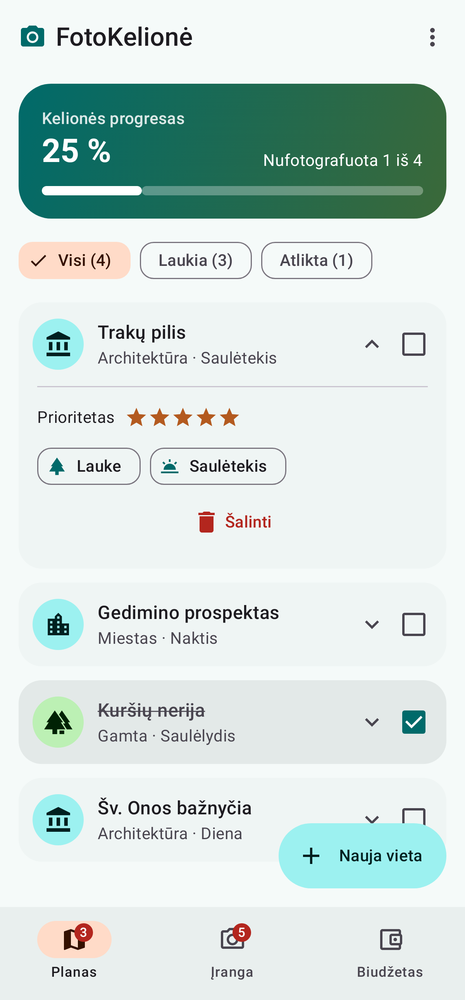
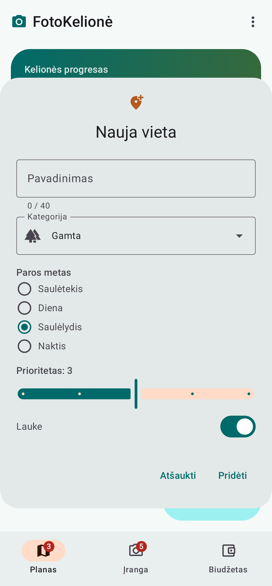
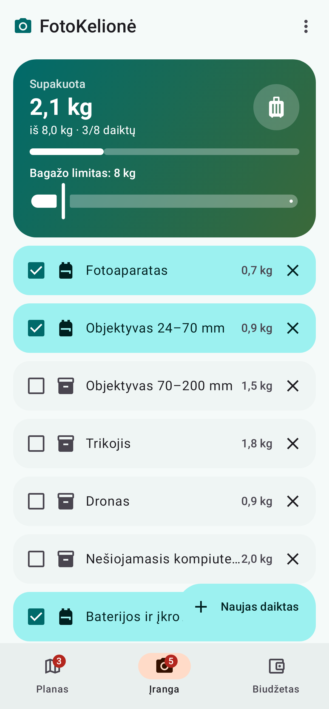
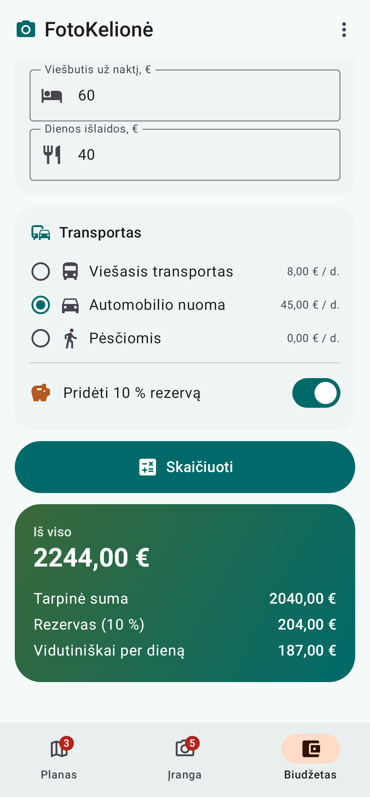

# FotoKelionė – gynimo gidas

Šis dokumentas padeda greitai rasti kiekvieną reikalavimą kode ir paaiškinti, kaip jis veikia.

## Kaip greitai rasti kodą Android Studio (Mac)

| Ką daryti | Klavišai |
| --- | --- |
| Rasti bet ką (failą, funkciją) | **Shift Shift** (du kartus) |
| Ieškoti teksto visame projekte | **Cmd + Shift + F** |
| Failo struktūra (visų funkcijų sąrašas) | **Cmd + F12** |
| Pereiti į funkcijos apibrėžimą | **Cmd + paspaudimas** ant pavadinimo |
| Grįžti atgal | **Cmd + [** |

Patarimas: kiekvieno failo viršuje yra komentaras su to failo turiniu, o prie kiekvieno elemento – didžiosiomis raidėmis parašyta, kas tai yra (pvz. `// SLANKIKLIS`, `// RADIJO MYGTUKAI`). Ieškokite **Cmd + Shift + F** žodžiu, pvz. `SLANKIKLIS`.

## Projekto struktūra

```
app/src/main/java/lt/vilniustech/fotokelione/
├── MainActivity.kt          ← programos pradžia (onCreate)
├── Logic.kt                 ← skaičiavimai ir tikrinimas (be UI)
├── PlannerViewModel.kt      ← duomenys ir veiksmai (būsena)
└── ui/
    ├── FotoKelioneApp.kt    ← Top App Bar, meniu „Autorius“, navigacija
    ├── components/
    │   └── Components.kt    ← bendri dizaino elementai (HeroCard ir kt.)
    ├── screens/
    │   ├── PlanScreen.kt    ← 1 ekranas „Planas“
    │   ├── GearScreen.kt    ← 2 ekranas „Įranga“
    │   └── BudgetScreen.kt  ← 3 ekranas „Biudžetas“
    └── theme/
        └── Theme.kt         ← spalvos, šriftai, kampai
app/src/test/java/lt/vilniustech/fotokelione/
└── LogicTest.kt             ← unit testai
```

**Kaip keliauja duomenys** (svarbiausia suprasti):

```
Vartotojas paspaudžia  →  Ekranas (PlanScreen) kviečia  →  viewModel.togglePlaceDone(id)
                                                               │
                                       pakeičia mutableStateListOf sąrašą
                                                               │
                         Compose pastebi pakeitimą ir PERPIEŠIA ekraną (recomposition)
```

## Reikalavimai → kur jie yra kode

### Ekranai

| Reikalavimas | Failas | Funkcija |
| --- | --- | --- |
| Vietų sąrašas | `PlanScreen.kt` | `PlanScreen`, `PlaceCard` |
| Filtras Visi / Laukia / Atlikta | `PlanScreen.kt` → `Logic.kt` | `FilterRow` → `filterPlaces` |
| Žymėti atlikta | `PlanScreen.kt` → `PlannerViewModel.kt` | `Checkbox` kortelėje → `togglePlaceDone` |
| Šalinti (+ „Atšaukti“) | `PlanScreen.kt` → `PlannerViewModel.kt` | `onDelete` → `removePlace` / `restorePlace` |
| Progreso juosta | `PlanScreen.kt` → `Logic.kt` | `ProgressHeader` → `placeProgress` |
| Pavadinimo tikrinimas | `PlanScreen.kt` → `Logic.kt` | `AddPlaceDialog` → `validateName` |
| Įrangos žymėjimas „supakuota“ | `GearScreen.kt` | `GearCard` → `toggleGearPacked` |
| Bendras svoris ir limitas | `GearScreen.kt` → `Logic.kt` | `WeightSummary` → `packedWeight`, `isOverLimit` |
| Įspėjimas viršijus limitą | `GearScreen.kt` | `WeightSummary` → `AnimatedVisibility(visible = overLimit)` |
| Biudžeto skaičiuoklė | `BudgetScreen.kt` → `PlannerViewModel.kt` → `Logic.kt` | `BudgetScreen` → `calculate` → `calculateBudget` |
| 10 % rezervas | `Logic.kt` | `calculateBudget` (`RESERVE_RATE = 0.10`) |
| Kablelis ir taškas | `Logic.kt` | `parseAmount` (`replace(',', '.')`) |
| Neigiamos / neskaitinės atmetamos | `Logic.kt` | `parseAmount` (`value < 0` → `null`) |

### Elementai (Material 3)

| Elementas | Kur rasti (Cmd + Shift + F) |
| --- | --- |
| Mygtukas (`Button`) | `BudgetScreen.kt` – „Skaičiuoti“ |
| FAB (`ExtendedFloatingActionButton`) | `PlanScreen.kt` – „Nauja vieta“, `GearScreen.kt` – „Naujas daiktas“ |
| Žymimasis langelis (`Checkbox`) | `PlaceCard`, `GearCard` |
| Jungiklis (`Switch`) | `AddPlaceDialog` (lauke), `BudgetScreen` (rezervas) |
| Radijo mygtukai (`RadioButton`) | `AddPlaceDialog` (paros metas), `TransportOption` |
| Slankiklis (`Slider`) | `AddPlaceDialog` (prioritetas), `WeightSummary` (limitas) |
| Filtro žymos (`FilterChip`) | `FilterRow` |
| Tekstiniai laukai (`OutlinedTextField`) | `AddPlaceDialog`, `AddGearDialog`, `AmountField` |
| Išskleidžiamas sąrašas (`ExposedDropdownMenuBox`) | `AddPlaceDialog` – kategorija |
| Tinklelis (`LazyVerticalGrid`) | `PlanScreen`, `GearScreen` |
| Kortelės (`Card`) | `PlaceCard`, `GearCard`, `HeroCard`, `SectionCard` |
| Progreso juostos (`LinearProgressIndicator`) | `ProgressHeader`, `WeightSummary` |
| Ženkliukas (`Badge`) | `FotoKelioneApp.kt` → `DestinationIcon` |
| Dialogai (`AlertDialog`) | `AddPlaceDialog`, `AddGearDialog`, `AuthorDialog` |
| `Snackbar` | `PlanScreen` → `snackbarHostState.showSnackbar` |
| Meniu (`DropdownMenu`) | `FotoKelioneApp.kt` – trijų taškų meniu |

### Animacijos

| Animacija | Kur |
| --- | --- |
| Kortelės išsiplėtimas `animateContentSize` | `PlaceCard` |
| Rodyklės pasisukimas `animateFloatAsState` | `PlaceCard` |
| Rezultato atsiradimas `AnimatedVisibility` | `BudgetScreen` (rezultatas), `WeightSummary` (įspėjimas) |

### Kiti reikalavimai

| Reikalavimas | Kur |
| --- | --- |
| Navigacija `NavHost` | `FotoKelioneApp.kt` |
| Apatinė juosta (telefonas) `NavigationBar` | `FotoKelioneApp.kt` → `bottomBar` |
| Šoninė juosta (planšetė) `NavigationRail` | `FotoKelioneApp.kt` → `if (useRail)` |
| Ekrano dydžio nustatymas | `MainActivity.kt` → `calculateWindowSizeClass`, `FotoKelioneApp.kt` → `useRail` |
| Tinklelis prisitaiko | `GridCells.Adaptive(minSize = ...)` `PlanScreen` ir `GearScreen` |
| Top App Bar + „Autorius“ | `FotoKelioneApp.kt` → `TopAppBar`, `AuthorDialog` |
| Prieinamumas (`contentDescription`) | ieškokite `contentDescription` – yra prie ikonų ir `Checkbox` |
| Logika atskirta | `Logic.kt` + `PlannerViewModel.kt` |
| Unit testai | `LogicTest.kt` |

## Unit testai

Paleisti: Android Studio → dešiniu pelės mygtuku ant `LogicTest.kt` → **Run 'LogicTest'**
(arba terminale `./gradlew testDebugUnitTest`). Iš viso 26 testai.

| Ką tikrina | Testai |
| --- | --- |
| Tuščias pavadinimas | `emptyNameIsRejected`, `blankNameIsRejected` |
| Per ilgas pavadinimas (ribos 40 / 41) | `nameAtMaxLengthIsAccepted`, `nameOverMaxLengthIsRejected` |
| Dalyba iš nulio | `divisionByZeroReturnsZero`, `progressOfEmptyListIsZero`, `budgetWithZeroNightsHasZeroPerDay` |
| Kablelis | `commaIsAcceptedAsDecimalSeparator`, `formattingUsesComma` |
| Neigiami ir ne skaičiai | `negativeAmountIsRejected`, `nonNumericAmountIsRejected` |
| Biudžeto formulė | `budgetFormulaWithoutReserve`, `budgetFormulaWithReserveAddsTenPercent` |

## Tikėtini klausimai ir atsakymai

**Kas yra Jetpack Compose?**
Būdas kurti Android UI Kotlin kodu, be XML. Ekranas aprašomas funkcijomis su `@Composable`. Kai pasikeičia duomenys (būsena), Compose pats perpiešia tik tą dalį, kuri pasikeitė.

**Kas yra būsena (state)?**
Reikšmė, kurią stebi Compose: `mutableStateOf(...)`, `mutableStateListOf(...)`. Ją pakeitus, ekranas atsinaujina automatiškai.

**Kuo skiriasi `remember` ir `rememberSaveable`?**
`remember` prisimena reikšmę, kol ekranas rodomas. `rememberSaveable` – išlieka ir pasukus telefoną. Pvz. dialogo laukai naudoja `rememberSaveable`, kad pasukus ekraną tekstas neišsitrintų.

**Kam reikalingas ViewModel?**
Jis laiko duomenis atskirai nuo ekrano ir išgyvena ekrano pasukimą. Visi trys ekranai naudoja tą patį `PlannerViewModel`, todėl duomenys išlieka pereinant tarp ekranų.

**Kodėl logika atskirta į `Logic.kt`?**
Funkcijos ten neturi jokio UI – gauna reikšmes, grąžina rezultatą. Todėl jas galima patikrinti unit testais nepaleidžiant programėlės.

**Kaip veikia navigacija?**
`NavHost` turi tris maršrutus (`"plan"`, `"gear"`, `"budget"`). Paspaudus juostos punktą kviečiama `navController.navigate(route)`.

**Kaip programėlė prisitaiko prie planšetės?**
`MainActivity` apskaičiuoja `WindowSizeClass`. Jei plotis ne `Compact` (planšetė, gulsčias ekranas), rodoma `NavigationRail` šone vietoj apatinės juostos. Tinkleliai naudoja `GridCells.Adaptive`, todėl stulpelių skaičius priklauso nuo pločio.

**Kaip skaičiuojamas biudžetas?**
`skrydis + naktys × (viešbutis + dienos išlaidos + transportas per dieną)`, prie to pridedama 10 %, jei įjungtas rezervas. Vidurkis per dieną = suma / naktys; jei naktų 0 – rodoma 0 (`safeDivide`).

**Kas nutinka įvedus „abc“ arba „-5“?**
`parseAmount` grąžina `null`, `calculate()` pažymi tą lauką klaida (`budgetErrors`), laukas tampa raudonas, rezultatas nerodomas.

**Kas yra `data class` ir `copy`?**
Klasė duomenims laikyti. `place.copy(done = true)` sukuria naują objektą su pakeistu vienu lauku – taip keičiame vietos būseną sąraše.

**Kas yra `enum class`?**
Fiksuotas reikšmių sąrašas, pvz. `Transport` turi tris variantus, kiekvienas su pavadinimu ir kaina per dieną.

**Kaip veikia „Atšaukti“ po šalinimo?**
`removePlace` grąžina pašalintą vietą ir jos poziciją. Jei Snackbar mygtukas paspaustas (`SnackbarResult.ActionPerformed`), kviečiama `restorePlace`, kuri grąžina vietą į tą pačią poziciją.

## Ekrano nuotraukos

| Planas | Nauja vieta | Įranga | Biudžetas |
| --- | --- | --- | --- |
|  |  |  |  |
